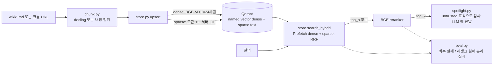

# ai-solo-studio-hybrid-rag

한국어 위키 하이브리드 RAG 지식 레이어와, 그 위에서 도는 멀티 에이전트 "1인 AI 게임 스튜디오" 전체 코드.

- 지식 레이어: Qdrant dense + sparse(IDF) RRF 융합, BGE-M3 리랭크
- 평가 하니스: 회수 실패(retrieval miss)와 리랭크 실패(rerank miss)를 나눠 집계
- 검색 결과 주입: untrusted 스팟라이팅(`orch/spotlight.py`)

> 해커톤 이전에 만든 개인 작업입니다. 해커톤 제출물과 무관합니다.
> 이 저장소는 비공개 원본에서 민감정보를 지운 공개용 사본입니다. 원본 git 이력은 포함하지 않습니다.

## 무엇인가

Owner 1명이 자연어로 지시하면 AI 직원(페르소나) 여러 명이 협업해 게임과 콘텐츠를 만드는 실험 프로젝트입니다. 코드 전체를 담았지만, 해커톤 포트폴리오 관점의 핵심은 `knowledge/` 지식 레이어입니다.

| 영역 | 경로 | 내용 |
|---|---|---|
| 지식 레이어 | `knowledge/` | 청킹, Qdrant 저장소, 하이브리드 검색, 평가, 크롤 인입, HTTP 검색 서비스 |
| 공용 클라이언트 | `core/` | BGE 임베딩/리랭크 클라이언트, 검색 응답 계약, 설정 로더 |
| 오케스트레이션 | `orch/` | LangGraph 코어(cycle, org, deliberation 그래프), 권한 게이트, provider primary/fallback, 스팟라이팅, 지식 수명주기 |
| 초기 엔진 | `office/`, `workflows/`, `bench/` | 워크플로 엔진, HITL 게이팅, 도구 호출 벤치 |
| 인터페이스 | `web/`, `web_server/`, `adapters/discord/` | 웹 오피스 UI(React, Phaser), SSE 서버, Discord 봇 |
| 게임 | `game/`, `games/` | 협동 게임 클라이언트, 생성된 웹 게임 |
| 평가 데이터 | `cases/`, `wiki/01~08` | 지식 평가셋 24문항과 평가 코퍼스 |
| 설계 문서 | `SR/renewal/`, `wiki/`, `docs/` | 구현 명세, 단계별 검증 게이트, 누적 지식 문서 |
| 배포 예시 | `deploy/`, `scripts/`, `tools/` | systemd 유닛, 검증 스크립트, 운영 도구 |

## 구성도 (지식 레이어)



- 저장: 청크 id 는 `source + chunk_id` 로 결정되어 같은 문서를 다시 넣어도 덮어쓰기
- 검색: dense 후보를 넓게(`top_n=20`) 모은 뒤 리랭커가 `top_k=5` 만 남김
- 평가 판정
  - 회수 실패: 정답이 후보 `top_n` 안에 아예 없음. sparse 보강 신호
  - 리랭크 실패: 후보에는 있으나 리랭크 뒤 `top_k` 밖으로 밀림
  - 성공: 리랭크 `top_k` 안에 정답 있음

## 실측 결과 (n=24)

원본 개발 환경의 실서버(BGE-M3-ko 임베딩, bge-reranker)로 잰 값입니다. 측정 당시 코퍼스는 `wiki/01~08` 의 55청크, 평가셋은 `cases/knowledge_eval.jsonl` 24문항(keyword 13, semantic 11)입니다.

| 구성 | Hit@1 | Hit@3 | Hit@5 | MRR |
|---|---|---|---|---|
| dense only | 95.8% | 100% | 100% | 0.979 |
| dense + 리랭커 | 95.8% | 100% | 100% | 0.972 |

| 분리 집계 | 건수 |
|---|---|
| 회수 실패 | 0 |
| 리랭크 실패 | 0 |
| 성공 | 24 |

- 순위 변경 관측 1건: `ke-04` dense 2위에서 리랭커 3위
- 하이브리드(RRF) 경로의 같은 형식 수치는 이 저장소에 기록이 없음
- 지금 `wiki/` 는 28개 문서라 `--full` 로 전체를 넣으면 코퍼스가 커져 수치가 달라질 수 있음

### 소표본 한계

- n=24 는 방향과 사례를 보는 신호용 표본. 통계적 유의성을 주장하지 않음
- 코퍼스가 작아 dense 가 이미 천장(Hit@3 100%). 리랭커 추가 이득을 이 데이터로 판단할 수 없음
- 키워드 질의의 dense 회수 실패가 0 이라 sparse 도입 효과도 이 표본으로 확인하지 못함

## 실행 방법 (지식 레이어)

요구: Python 3.12 이상, Docker(또는 Podman), BGE 임베딩/리랭크 HTTP 서버.

1. 의존성 설치

   ```bash
   pip install -e ".[knowledge,test]"
   # 선택: 구조 인식 청킹
   pip install -e ".[chunking]"
   ```

2. Qdrant 실행. 포트는 `config/endpoint.yaml` 의 `knowledge.qdrant_url` 과 같음

   ```bash
   docker compose up -d qdrant
   ```

3. 환경변수 설정

   ```bash
   cp .env.example .env
   # BGE_EMBEDDING_API_URL, BGE_EMBEDDING_API_KEY, BGE_EMBEDDING_MODEL,
   # BGE_RERANK_API_URL, BGE_RERANK_API_KEY 를 채움
   ```

   - BGE 서버 형식: `POST {"model", "texts"}` 에 `{"dense_embeddings": [[float]]}` 응답(`core/bge_client.py`)

4. 인덱싱과 평가

   ```bash
   python -m knowledge.ingest wiki
   python -m knowledge.eval cases/knowledge_eval.jsonl
   # 실서버 왕복 확인과 전체 측정
   python -m knowledge.run_eval --smoke
   python -m knowledge.run_eval --full
   ```

5. 오프라인 테스트(외부 서버 불필요, 결정론 fake embedder 사용)

   ```bash
   pytest -m "not slow" knowledge/tests tests/test_knowledge_*.py
   ```

   - `tests/test_rerank.py::test_bge_rerank_env_vars_present` 는 `.env` 에 `BGE_RERANK_*` 가 있어야 통과

웹 UI 와 게임 클라이언트:

```bash
cd web && npm ci && npm run build
cd game && npm ci && npx tsc --noEmit
```

## 공개본에서 바뀐 점

| 항목 | 처리 |
|---|---|
| 도메인, 호스트명 | `studio.example.com`, `app-host.example.internal` 로 가명 처리 |
| LAN IP | 문서용 예약 대역 `192.0.2.41` 로 교체 |
| 서버 절대경로 | `/opt/conda`, `/opt/studio`, `/srv/office`, `/etc/studio/ssl` 같은 일반 경로로 교체 |
| 개인 메일, 메일 릴레이 계정 | `example.com` 계열 가상 값으로 교체 |
| 계정명, 외부 서비스 프로젝트 id | `<owner>`, `<stitch-project-id>`, `<stitch-screen-id>` 자리표시자로 교체. 셸 프롬프트는 `user@host`, node 경로는 `/usr/local/bin/node`(환경변수로 바꿀 수 있음)로 교체 |
| 예시 메일 주소 | 테스트 케이스의 메일 도메인을 `example.com` 하위 도메인으로 교체 |
| 디자인 시안 HTML(`work/stitch/`) | 외부에 호스팅된 생성 이미지 링크를 인라인 투명 1px 이미지로 교체 |
| 윤문 룰북(`orch/humanize_rules.md`) | 외부 자료 대신 이 저장소에서 직접 쓴 룰북으로 교체 |
| 참고 자료 링크 | 개인 저장소와 영상 링크를 일반 설명으로 교체 |
| 에이전트 세션 산출물(`.omc/` 대부분, 진행 로그) | 제외. 코드가 쓰는 `.omc/guards/*.sh` 와 `.omc/state/` 동결 해시만 포함 |
| 이미지 에셋 | 원본 이미지(LPC, Tuxemon 파생물, 생성 초상화, 디자인 시안)는 제외. `web/public/assets/` 는 같은 크기의 체크무늬 자리표시 이미지로 대체. `web/public/assets/PLACEHOLDERS.md` 참고 |
| 비밀값 | 포함한 파일에서 실제 키 검출 0(detect-secrets, 정규식 검사). 모든 키는 `.env.example` 에 이름만 있음 |

## 한계

- 원본은 단일 서버 운영을 전제로 함. `deploy/`, `SR/renewal/verify_phase*.sh` 는 그 환경 기준이라 그대로는 돌지 않음
- LLM, 이미지 생성, Discord, WorkAdventure 경로는 각자 외부 서비스와 키가 있어야 동작
- `orch` API 의 `ORCH_API_KEY_RW`, `ORCH_API_KEY_RO` 를 비우면 테스트용 공개 기본값(`orch/app.py`, `orch/drive_phase_c.py`)을 씀. 배포할 때는 반드시 두 값을 설정해야 함
- 웹 오피스는 자리표시 이미지로 뜨므로 원본 화면과 다름
- 문서 다수가 개발 당시의 작업 기록 문체(한국어, 약어 많음)로 남아 있음

## 라이선스

Apache License 2.0. `LICENSE` 참고.
